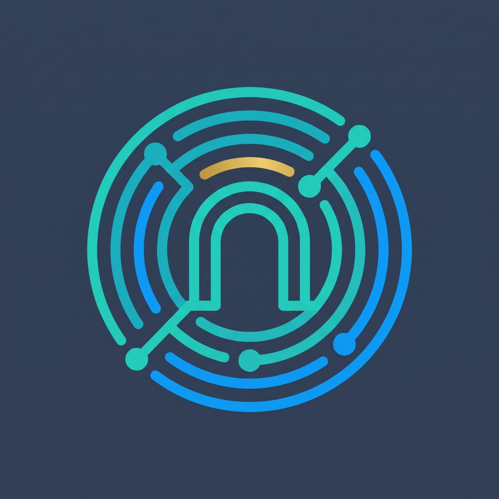
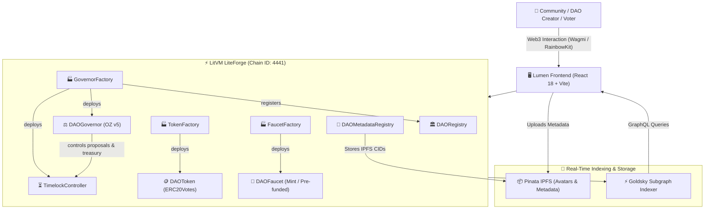

<p align="center">
  
</p>

<h1 align="center">Lumen</h1>

<p align="center">
  <strong>Native Onchain Governance Protocol & DAO Operating System for LitVM LiteForge</strong>
</p>

<p align="center">
  <a href="https://liteforge.explorer.caldera.xyz"></a>
  <a href="https://book.getfoundry.sh/"></a>
  <a href="https://www.openzeppelin.com/contracts"></a>
  <a href="https://goldsky.com/"></a>
  <a href="https://vitejs.dev/"></a>
  <a href="https://tailwindcss.com/"></a>
  <a href="https://x.com/thelumenxyz"></a>
</p>

---

## Table of Contents

- [Overview](#overview)
- [System Architecture](#system-architecture)
- [Key Features](#key-features)
- [Deployed Contracts & Network Info](#deployed-contracts--network-info)
- [Repository Structure](#repository-structure)
- [Prerequisites](#prerequisites)
- [Getting Started](#getting-started)
  - [1. Root Monorepo Setup](#1-root-monorepo-setup)
  - [2. Frontend Development](#2-frontend-development)
  - [3. Smart Contracts Development](#3-smart-contracts-development)
  - [4. Indexer Development](#4-indexer-development)
- [Environment Configuration](#environment-configuration)
- [GraphQL Subgraph API](#graphql-subgraph-api)
- [Security & Architecture Design](#security--architecture-design)
- [License](#license)

---

## Overview

**Lumen** is a full-stack, modular governance infrastructure protocol built natively for **LitVM LiteForge (Chain ID: 4441)**. 

Lumen empowers communities, developers, and autonomous agents to launch production-grade decentralized organizations in minutes. Every DAO deployed on Lumen features:
- Standard OpenZeppelin ERC20Votes governance tokens with snapshot voting power.
- Multi-step OpenZeppelin Governor architectures secured by dedicated TimelockControllers.
- An immutable onchain registry and an extensible decentralized metadata registry backed by IPFS.
- Automated token faucets for community onboarding (supporting both mint and pre-funded drip modes).
- Low-latency real-time subgraph indexing powered by Goldsky.

---

## System Architecture



---

## Key Features

### 1. Guided Multi-Step DAO Deployment
- **Token Deployment**: Create custom `ERC20Votes` tokens with customizable initial supply, token symbol, and auto-delegation.
- **Governor & Timelock Wiring**: Set voting delays, voting periods, proposal thresholds, quorum percentages, and minimum timelock delays atomically.
- **Factory Ownership Renunciation**: Factories configure mutual roles between Governor and Timelock, then immediately renounce administrative privileges to preserve decentralization.

### 2. Dual-Mode Community Faucets
- **Mint Mode**: Grants the faucet contract `MINTER_ROLE` on the governance token, allowing continuous token drops to new community members with enforced claim limits and cooldown periods.
- **Pre-Funded Mode**: The creator deposits an allocation into the faucet contract, allowing controlled drip distribution without token minting inflation.

### 3. Onchain Registry & Decentralized Metadata
- **DAORegistry**: Enumerable tracking of all active DAOs, governors, tokens, and timelocks deployed across the network.
- **DAOMetadataRegistry**: Stores immutable or updatable IPFS content identifiers (CIDs) for avatars, community manifestos, and social links. Access-restricted to DAO creators and the Timelock.

### 4. Full Proposal Lifecycle Tracking
- **Interactive Voting**: Support for For / Against / Abstain voting with real-time tally visualization.
- **Timelock Automation**: Multi-phase proposal progression: `Pending` &rarr; `Active` &rarr; `Succeeded / Defeated` &rarr; `Queued` &rarr; `Executed`.

### 5. High-Throughput Subgraph Indexing
- Tailored AssemblyScript mappings indexing contract factories and dynamically spawned templates (`GovernorTemplate`, `TokenTemplate`, `FaucetTemplate`).
- Computes real-time token holder counts, circulating distributions, proposal states, voting weight tallies, and claim records.

### 6. Robust Caldera Gas Management
- Built-in safe fee calculation with base fee multipliers and priority fee defaults to ensure smooth transaction submission on Caldera Arbitrum Nitro rollups.

---

## Deployed Contracts & Network Info

### Network Configuration (LitVM LiteForge)

| Property | Value |
| :--- | :--- |
| **Network Name** | LitVM LiteForge (Caldera Rollup) |
| **Chain ID** | `4441` |
| **Native Currency** | `zkLTC` (18 decimals) |
| **RPC URL (HTTP)** | `https://liteforge.rpc.caldera.xyz/http` |
| **RPC URL (WS)** | `wss://liteforge.rpc.caldera.xyz/ws` |
| **Block Explorer** | [https://liteforge.explorer.caldera.xyz](https://liteforge.explorer.caldera.xyz) |
| **Faucet Hub** | [https://liteforge.hub.caldera.xyz](https://liteforge.hub.caldera.xyz) |

### Core Factory & Registry Contracts

| Contract | Address | Description |
| :--- | :--- | :--- |
| **`DAORegistry`** | [`0xfF8c3453f5617C0483e3D2f38F70126772D6F247`](https://liteforge.explorer.caldera.xyz/address/0xfF8c3453f5617C0483e3D2f38F70126772D6F247) | Central registry mapping governors, tokens, and timelocks |
| **`DAOMetadataRegistry`** | [`0x92621936C0E61E0371bFE2A5BC37f7569ca3e9a2`](https://liteforge.explorer.caldera.xyz/address/0x92621936C0E61E0371bFE2A5BC37f7569ca3e9a2) | Stores IPFS CIDs for DAO branding and descriptions |
| **`TokenFactory`** | [`0x9b3E75Df9bBBCD2b60645ecb473d838f3eAa5dea`](https://liteforge.explorer.caldera.xyz/address/0x9b3E75Df9bBBCD2b60645ecb473d838f3eAa5dea) | Deploys `DAOToken` instances with auto-delegation |
| **`GovernorFactory`** | [`0xfE6e5f87AA0be25c73BeF342217F2b170C9e38a2`](https://liteforge.explorer.caldera.xyz/address/0xfE6e5f87AA0be25c73BeF342217F2b170C9e38a2) | Atomically deploys Governor + TimelockController |
| **`GovernorDeployer`** | [`0xA2913242e845D883df43676C0e253D9eDc0605B2`](https://liteforge.explorer.caldera.xyz/address/0xA2913242e845D883df43676C0e253D9eDc0605B2) | Bytecode deployment module for OZ Governors |
| **`FaucetFactory`** | [`0x01aD919d404Cd4a67F990499753fEBB78d21ED6b`](https://liteforge.explorer.caldera.xyz/address/0x01aD919d404Cd4a67F990499753fEBB78d21ED6b) | Deploys community faucets for governance tokens |

---

## Repository Structure

```plaintext
LitDAO/
├── contracts/                  # Foundry smart contracts suite
│   ├── src/                    # Solidity source contracts
│   │   ├── DAORegistry.sol     # Central registry
│   │   ├── DAOMetadataRegistry.sol # IPFS metadata registry
│   │   ├── DAOToken.sol        # ERC20Votes governance token
│   │   ├── TokenFactory.sol    # Token deployer factory
│   │   ├── DAOGovernor.sol     # OpenZeppelin Governor implementation
│   │   ├── GovernorFactory.sol # Governor + Timelock deployer
│   │   ├── GovernorDeployer.sol# Bytecode deployer
│   │   ├── DAOFaucet.sol       # Dual-mode token faucet
│   │   └── FaucetFactory.sol   # Faucet deployer
│   ├── test/                   # Foundry tests (unit, fuzz, lifecycle)
│   ├── script/                 # Forge deployment & verification scripts
│   └── foundry.toml            # Foundry configuration
│
├── frontend/                   # React 18 + Vite frontend
│   ├── src/
│   │   ├── components/         # Navbar, banners, cards, modals
│   │   ├── pages/              # ExplorePage, DaoDetailPage, ProposalDetailPage, CreateDaoPage
│   │   ├── config/             # Wagmi, Caldera chain, contract ABIs
│   │   ├── services/           # Pinata IPFS & Goldsky GraphQL services
│   │   └── types/              # TypeScript interface definitions
│   ├── public/                 # Static assets & Lumen branding logo
│   └── vite.config.ts          # Vite build config
│
├── indexer/                    # Goldsky Subgraph indexer
│   ├── schema.graphql          # GraphQL entities (DAO, Proposal, Vote, Token, Faucet)
│   ├── subgraph.yaml           # Subgraph manifest & event mappings
│   ├── src/                    # AssemblyScript event handlers
│   └── abis/                   # Contract ABIs for type generation
│
└── package.json                # Monorepo task runner
```

---

## Prerequisites

- **Node.js**: `>= 20.18.1`
- **npm** or **bun**
- **Foundry** (`forge`, `cast`): [Install Foundry](https://getfoundry.sh/)
- **Goldsky CLI** (optional, for deploying the indexer):
  ```bash
  curl https://goldsky.com | sh
  ```

---

## Getting Started

### 1. Root Monorepo Setup

Clone the repository and install root and frontend dependencies:

```bash
git clone https://github.com/mr-metawin/LitDAO.git
cd LitDAO

# Install frontend dependencies
cd frontend && npm install && cd ..
```

### 2. Frontend Development

To launch the frontend development server:

```bash
# Run from repository root
npm run dev

# Or directly from frontend/
cd frontend
npm run dev
```

Visit `http://localhost:5173` in your browser.

To verify the production build:

```bash
npm run build
```

### 3. Smart Contracts Development

Navigate to `contracts/`:

```bash
cd contracts

# Build the contracts
forge build

# Run the test suite (36 tests including fuzz tests)
forge test -vv
```

To run a single test suite:

```bash
forge test --match-contract GovernanceLifecycleTest -vv
```

#### Deploying Contracts to LitVM LiteForge

```bash
forge script script/DeployLitDAO.s.sol:DeployLitDAO \
  --rpc-url https://liteforge.rpc.caldera.xyz/http \
  --broadcast \
  --private-key <YOUR_PRIVATE_KEY>
```

### 4. Indexer Development

Navigate to `indexer/`:

```bash
cd indexer
npm install

# Generate AssemblyScript types from schema.graphql and ABIs
npm run codegen

# Compile WebAssembly mappings
npm run build

# Deploy to Goldsky
goldsky subgraph deploy litdao/1.0.1 --path .
```

---

## Environment Configuration

### Frontend (`frontend/.env`)

```env
# Pinata IPFS Credentials
VITE_PINATA_JWT=your_pinata_jwt_token_here
VITE_PINATA_GATEWAY=https://your_gateway.mypinata.cloud

# Goldsky GraphQL Indexer Endpoint
VITE_GOLDSKY_GRAPHQL_URL=https://api.goldsky.com/api/public/project_cm2amh4pghfqk01wega7t4x7l/subgraphs/litdao/1.0.1/gn
```

### Contracts (`contracts/.env`)

```env
RPC_URL="https://liteforge.rpc.caldera.xyz/http"
RPC_WS_URL="wss://liteforge.rpc.caldera.xyz/ws"
CHAIN_ID="4441"
EXPLORER_URL="https://liteforge.explorer.caldera.xyz"
EXPLORER_API_URL="https://liteforge.explorer.caldera.xyz/api"
CAST_ACCOUNT="your_cast_keystore_name"
```

---

## GraphQL Subgraph API

Production Subgraph Endpoint:
```
https://api.goldsky.com/api/public/project_cm2amh4pghfqk01wega7t4x7l/subgraphs/litdao/1.0.1/gn
```

### Sample Query: Fetch Active DAOs & Tokens

```graphql
query GetAllDAOs {
  daos(orderBy: createdAt, orderDirection: desc) {
    id
    name
    governor
    token
    timelock
    registrant
    imageUri
    description
    createdAt
    createdBlock
    proposalCount
    voterCount
    holderCount
  }
  tokens {
    id
    name
    symbol
  }
}
```

### Sample Query: Fetch DAO Details with Proposals

```graphql
query GetDAOById($id: ID!) {
  dao(id: $id) {
    id
    name
    governor
    token
    timelock
    holderCount
    proposalCount
    proposals(orderBy: createdAt, orderDirection: desc) {
      id
      proposalId
      proposer
      description
      status
      forVotes
      againstVotes
      abstainVotes
      startBlock
      endBlock
    }
  }
}
```

---

## Security & Architecture Design

1. **Battle-Tested OpenZeppelin v5.0 Foundation**:
   - `DAOGovernor` utilizes modular extensions (`GovernorSettings`, `GovernorVotes`, `GovernorVotesQuorumFraction`, `GovernorTimelockControl`).
   - `DAOToken` strictly adheres to `ERC20Votes` with checkpointing and snapshot delegation.
2. **Strict Separation of Powers**:
   - The `TimelockController` holds treasury ownership and execution privileges.
   - The `DAOGovernor` holds `PROPOSER_ROLE` and `CANCELLER_ROLE`.
   - `EXECUTOR_ROLE` is permissionless (`address(0)`), guaranteeing that anyone can execute a passed and queued proposal once the timelock delay elapses.
3. **Atomic Factory Wiring**:
   - `GovernorFactory` registers the DAO in `DAORegistry` atomically during creation.
   - Factory contracts immediately renounce all administrative roles upon deployment completion.
4. **Resilient Caldera RPC Integration**:
   - Dynamic priority fee and base fee multiplier buffers prevent replacement underpriced or gas floor revert conditions on the sequencer.

---

## License

This project is licensed under the [MIT License](LICENSE).
